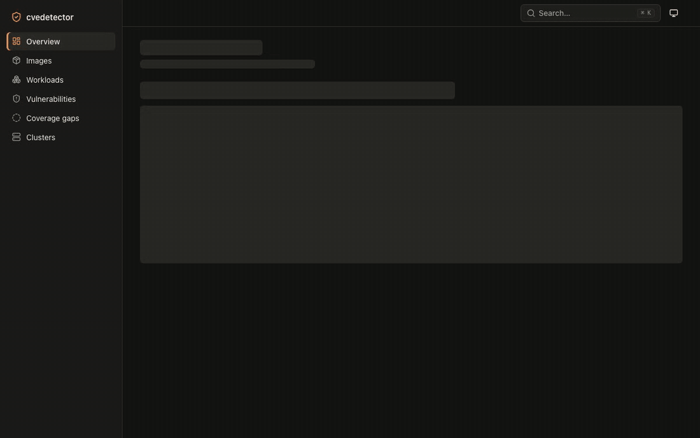

<p align="center">
  
</p>

<h1 align="center">cvedetector</h1>

<p align="center">
  See which known CVEs affect the container images running in your Kubernetes clusters right now, and track them over time. Nothing is pulled or scanned.
</p>

<p align="center">
  <a href="https://huseyinbabal.github.io/cvedetector/getting-started/quick-start/"><b>Quick start</b></a> ·
  <a href="https://huseyinbabal.github.io/cvedetector/"><b>Documentation</b></a> ·
  <a href="https://huseyinbabal.github.io/cvedetector/guides/add-a-product/"><b>Add an image to the feed</b></a> ·
  <a href="https://huseyinbabal.github.io/cvedetector/guides/development/"><b>Contributing</b></a>
</p>



```sh
helm repo add huseyinbabal https://huseyinbabal.github.io/charts
helm install cvedetector huseyinbabal/cvedetector -n cvedetector --create-namespace
```
